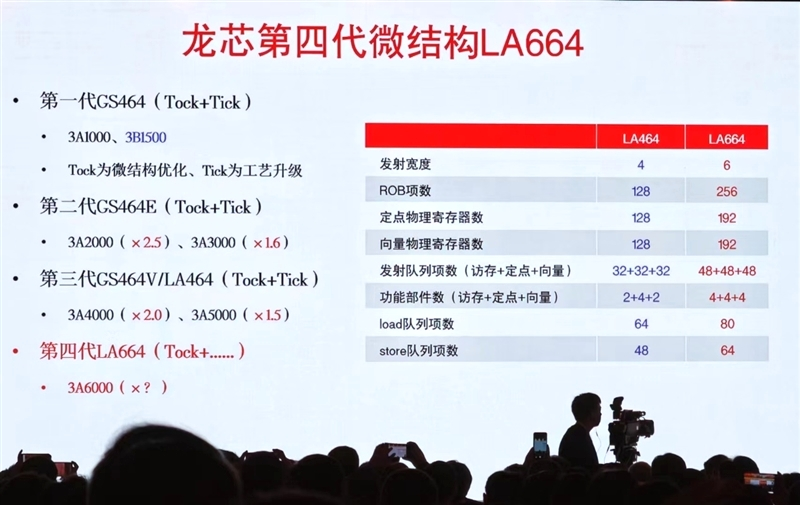
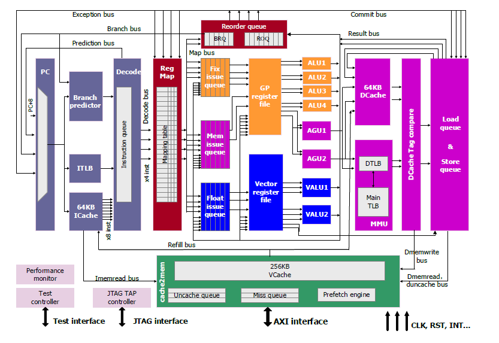

# Loongson LA464 微架构评测

## 背景

之前分析了很多国外的微架构，而龙芯的微架构一直都没怎么研究过。既然 LA864 快要来了，那就在它来之前分析一下 LA464 和 [LA664](./loongson-la664.md)。

<!-- more -->

## 官方信息

Loongson 关于 LA464 微架构有这些官方的信息：

- [龙芯 3A5000 产品页](https://www.loongson.cn/product/show?id=10)：2.3GHz-2.5GHz，160GFlops，4 核，典型功耗 35W@2.5GHz
- [龙芯 3C5000 产品页](https://www.loongson.cn/product/show?id=15)：16 核 LA464，2.0GHz-2.2GHz，560GFlops@2.2GHz
- [龙芯 3A5000 发布报道](https://www.loongson.cn/news/show?id=1)：4 个定点单元、2 个 256 位向量运算单元和 2 个访存单元
- [3A5000/3B5000 用户手册（英文版）LA464 章节](https://github.com/loongson-community/LoongArch-Documentation/blob/main/docs/Loongson-3A5000-usermanual-EN/la464-processor-core.adoc)
- [龙芯官网下载中心](https://www.loongson.cn/download/index)：《龙芯 3A5000/3B5000 处理器数据手册》《龙芯 3A5000/3B5000 处理器寄存器使用手册》（第 8 章为 LA464 处理器核）

2023 年的龙芯产品发布暨用户大会上，胡伟武在介绍 LA664 时一并给出了 LA464 的微架构参数：

（图片来源：[快科技 2023-11-29 现场报道](https://news.mydrivers.com/1/948/948522.htm)）

其中 LA464 的官方数字如下：

| 参数 | LA464 |
| --- | --- |
| 发射宽度 | 4 |
| ROB 项数 | 128 |
| 定点物理寄存器数 | 128 |
| 向量物理寄存器数 | 128 |
| 发射队列项数（访存+定点+向量） | 32+32+32 |
| 功能部件数（访存+定点+向量） | 2+4+2 |
| load 队列项数 | 64 |
| store 队列项数 | 48 |

手册给出的其他细节：

- 四发射超标量结构，4 个定点、2 个向量、2 个访存部件
- 每个向量部件 256 位宽，最多支持 8 个单精度或 4 个双精度乘加运算
- 访存部件支持 256 位访问，虚地址 64 位、物理地址 48 位
- 64 项全相联外加 8 路组相联 2048 项，共 2112 项 TLB，另有 64 项指令 TLB，支持可变页大小
- L1I 和 L1D 各 64KB，4 路组相联；256KB Victim Cache 作为私有二级 Cache，16 路组相联
- 支持 Non-blocking 访问与 Load-Speculation 等访存优化技术；L1 Cache 奇偶校验，L2 和末级 Cache ECC 校验

官方手册给出的 LA464 结构如下图所示，其中有 4 条译码通路（Decode bus 上的 4 inst）、4 个定点 ALU、2 个 256 位向量单元 VAL1/VAL2 和 2 个地址生成单元 AGU1/AGU2：

整个 3A5000 芯片的结构如下：

## 现有评测

网上已经有较多针对 LA464 微架构的评测和分析，建议阅读：

- [Loongson’s 3A5000: China’s Best Shot?](https://old.chipsandcheese.com/2023/04/09/loongsons-3a5000-chinas-best-shot/)

下面分各个模块分别记录官方提供的信息，以及实测的结果。读者可以对照已有的第三方评测理解。官方信息与实测结果一致的数据会加粗。

## Benchmark

Loongson LA464 的性能测试结果见 [SPEC](../../../benchmark/index.md)。

## 前端

### Fetch

官方信息：LA464 是四发射超标量处理器核，结构图中译码带宽为每周期 4 条指令。

### Decode

官方信息：四发射；发射队列分为访存、定点、向量三类，每类 32 项。

### L1 ITLB

官方信息：64 项指令 TLB。

### L1 ICache

官方信息：64KB，4 路组相联。

### Return Stack

## 后端

### Rename

官方信息：定点物理寄存器 128 项、向量物理寄存器 128 项；ROB 128 项。

### Execution Units

官方信息：4 个定点、2 个向量、2 个访存功能部件。每个向量部件 256 位宽，最多支持 8 个单精度或 4 个双精度乘加运算。

### LSU

官方信息：访存部件支持 256 位存储访问，虚地址 64 位、物理地址 48 位；load 队列 64 项、store 队列 48 项；支持 Non-blocking 访问和 Load-Speculation。

#### Load Store 带宽

#### Store to Load Forwarding

### Memory Dependency Predictor

### L1 DCache

官方信息：64KB，4 路组相联。

### L1 DTLB

官方信息：64 项全相联加 2048 项 8 路组相联，共 2112 项 TLB，另有 64 项指令 TLB。

### L2 TLB

官方信息：手册给出的 2112 项 TLB 中，除 64 项全相联部分外，其余 2048 项为 8 路组相联，支持可变页大小。

### L2 Cache

官方信息：256KB Victim Cache，16 路组相联，每核私有；4 个核共享 16MB 分体三级 Cache。

### Prefetcher

官方信息：结构图中 L2（VCACHE）内有一个 Prefetch engine。

#### 预取延迟

#### 预取距离

#### 是否跨页

### ReOrder Buffer

官方信息：ROB 128 项。
