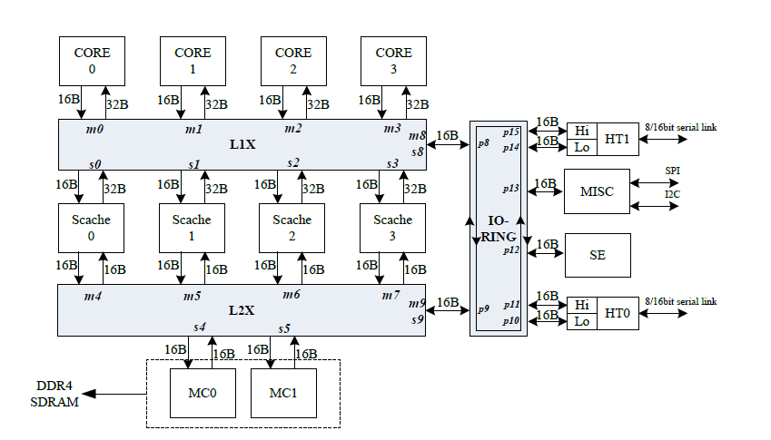
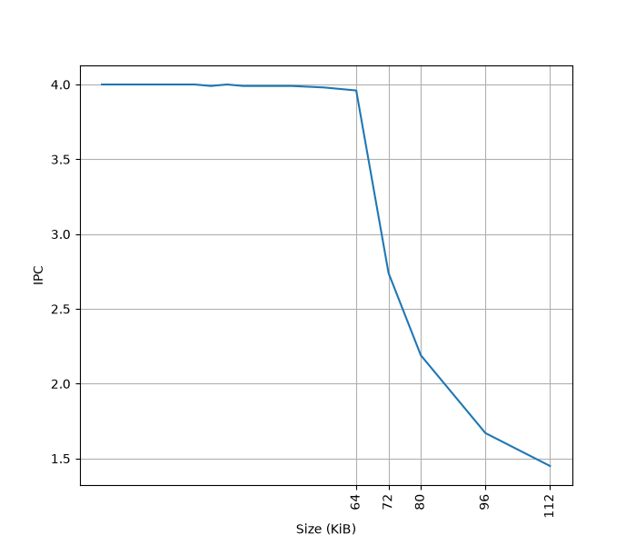
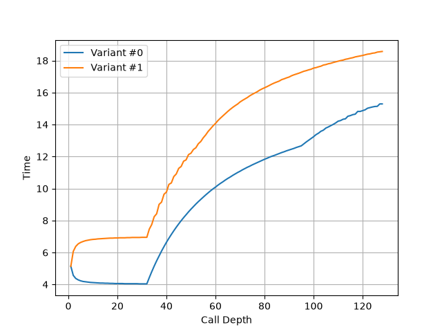
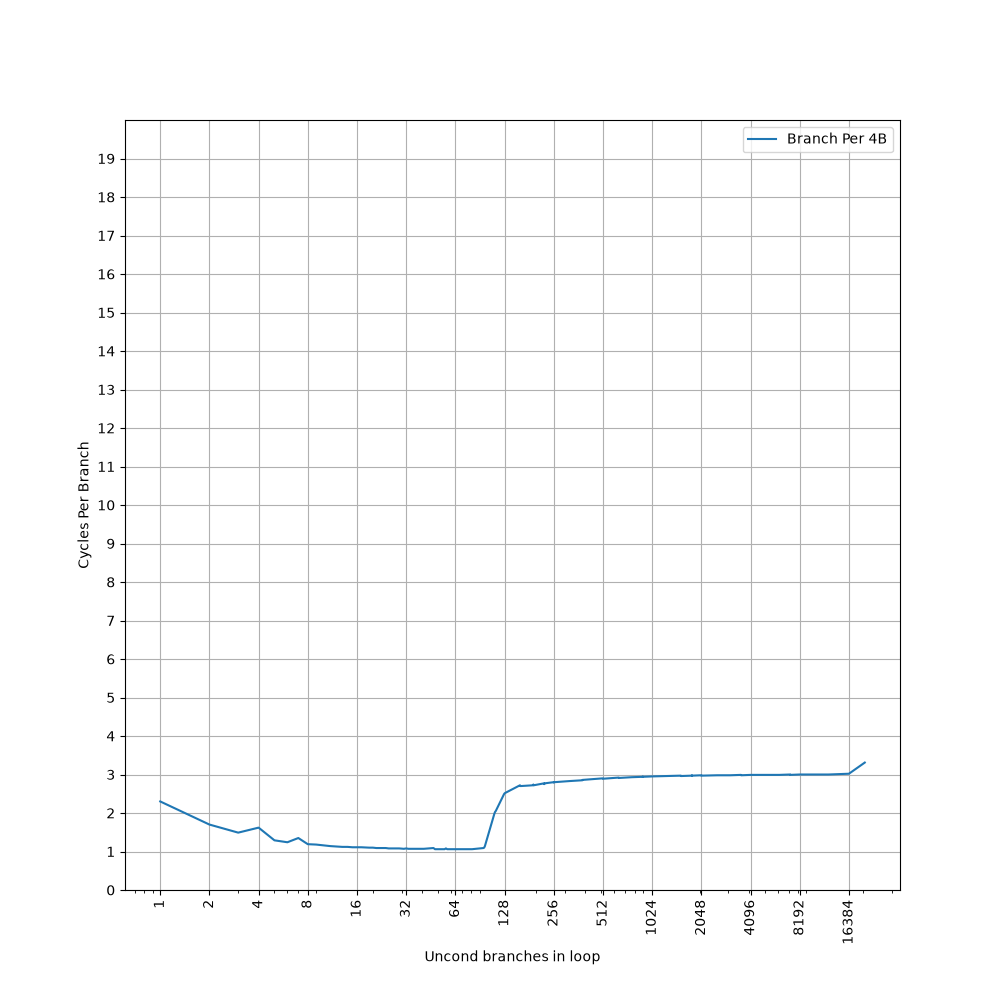
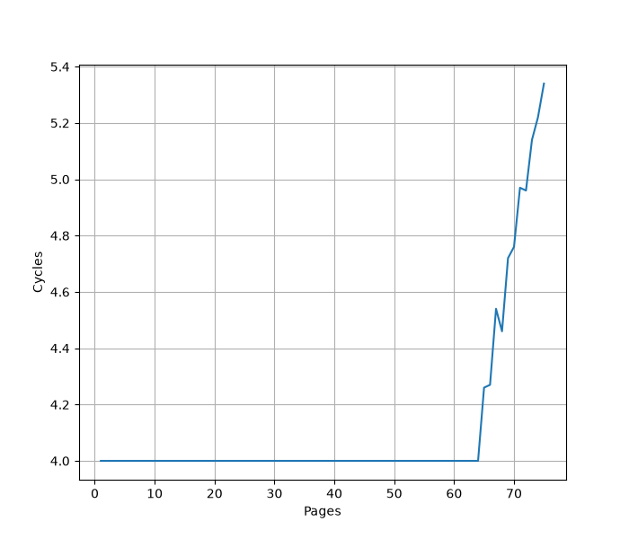
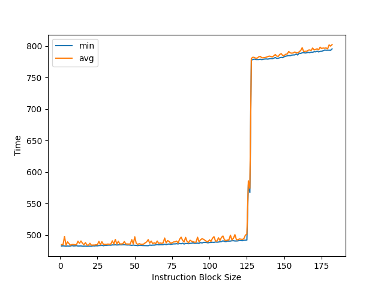

# Loongson LA464 微架构评测

## 背景

之前分析了很多国外的微架构，而龙芯的微架构一直都没怎么研究过。既然 LA864 快要来了，那就在它来之前分析一下 LA464 和 [LA664](./loongson-la664.md)。

<!-- more -->

## 官方信息

Loongson 关于 LA464 微架构有这些官方的信息：

- [龙芯 3A5000 产品页](https://www.loongson.cn/product/show?id=10)：2.3GHz-2.5GHz，160GFlops，4 核，典型功耗 35W@2.5GHz
- [龙芯 3C5000 产品页](https://www.loongson.cn/product/show?id=15)：16 核 LA464，2.0GHz-2.2GHz，560GFlops@2.2GHz
- [龙芯 3A5000 发布报道](https://www.loongson.cn/news/show?id=1)：4 个定点单元、2 个 256 位向量运算单元和 2 个访存单元
- [3A5000/3B5000 用户手册（英文版）LA464 章节](https://github.com/loongson-community/LoongArch-Documentation/blob/main/docs/Loongson-3A5000-usermanual-EN/la464-processor-core.adoc)
- [龙芯官网下载中心](https://www.loongson.cn/download/index)：《龙芯 3A5000/3B5000 处理器数据手册》《龙芯 3A5000/3B5000 处理器寄存器使用手册》（第 8 章为 LA464 处理器核）

2023 年的龙芯产品发布暨用户大会上，胡伟武在介绍 LA664 时一并给出了 LA464 的微架构参数：

（图片来源：[快科技 2023-11-29 现场报道](https://news.mydrivers.com/1/948/948522.htm)）

其中 LA464 的官方数字如下：

| 参数                         | LA464    |
|------------------------------|----------|
| 发射宽度                     | 4        |
| ROB 项数                     | 128      |
| 定点物理寄存器数             | 128      |
| 向量物理寄存器数             | 128      |
| 发射队列项数（访存+定点+向量） | 32+32+32 |
| 功能部件数（访存+定点+向量）   | 2+4+2    |
| load 队列项数                | 64       |
| store 队列项数               | 48       |

手册给出的其他细节：

- 四发射超标量结构，4 个定点、2 个向量、2 个访存部件
- 每个向量部件 256 位宽，最多支持 8 个单精度或 4 个双精度乘加运算
- 访存部件支持 256 位访问，虚地址 64 位、物理地址 48 位
- 64 项全相联外加 8 路组相联 2048 项，共 2112 项 TLB，另有 64 项指令 TLB，支持可变页大小
- L1I 和 L1D 各 64KB，4 路组相联；256KB Victim Cache 作为私有二级 Cache，16 路组相联
- 支持 Non-blocking 访问与 Load-Speculation 等访存优化技术；L1 Cache 奇偶校验，L2 和末级 Cache ECC 校验

官方手册给出的 LA464 结构如下图所示，其中有 4 条译码通路（Decode bus 上的 4 inst）、4 个定点 ALU、2 个 256 位向量单元 VAL1/VAL2 和 2 个地址生成单元 AGU1/AGU2：

整个 3A5000 芯片的结构如下：

## 现有评测

网上已经有较多针对 LA464 微架构的评测和分析，建议阅读：

- [Loongson’s 3A5000: China’s Best Shot?](https://old.chipsandcheese.com/2023/04/09/loongsons-3a5000-chinas-best-shot/)

下面分各个模块分别记录官方提供的信息，以及实测的结果。读者可以对照已有的第三方评测理解。官方信息与实测结果一致的数据会加粗。

## Benchmark

Loongson LA464 的性能测试结果见 [SPEC](../../../benchmark/index.md)。

## 前端

### Fetch

官方信息：取指宽度为**四**。

为了测试实际的 Fetch 宽度，参考 [如何测量真正的取指带宽（I-fetch width） - JamesAslan](https://zhuanlan.zhihu.com/p/720136752) 构造了测试。

其原理是当 Fetch 要跨页的时候，由于两个相邻页可能映射到不同的物理地址，如果要支持单周期跨页取指，需要查询两次 ITLB，或者 ITLB 需要把相邻两个页的映射存在一起。这个场景一般比较少，处理器很少会针对这种特殊情况做优化，但也不是没有。经过测试，把循环放在两个页的边界上，发现 LA464 微架构遇到跨页的取指时确实会拆成两个周期来进行。

在此基础上，构造一个循环，循环的第一条指令放在第一个页的最后四个字节，其余指令放第二个页上，那么每次循环的取指时间，就是一个周期（读取第一个页内的指令）加上第二个页内指令需要 Fetch 的周期数，多的这一个周期就足以把 Fetch 宽度从后端限制中区分开，实验结果如下：

图中蓝线（cross-page）表示的就是上面所述的第一条指令放一个页，其余指令放第二个页的情况，横坐标是第二个页内的指令数，那么一次循环的指令数等于横坐标 +1。纵坐标是运行很多次循环的总 cycle 数除以循环次数，也就是平均每次循环耗费的周期数。可以看到，到 9 条指令的时候，多了一个周期，意味着前 8 条指令只需要两个周期，每个周期取 4 条指令。

为了确认这个瓶颈是由取指造成的，又构造了一组实验，把循环的所有指令都放到一个页中，这个时候 Fetch 不再成为瓶颈（图中 aligned），两个曲线的对比可以明确地得出上述结论。

随着指令数进一步增加，最终瓶颈在每周期执行的 NOP 指令数，因此两条线重合。

### Decode

官方信息：译码宽度为四。

### L1 ITLB

官方信息：**64 项**指令 TLB。

构造一系列的 B 指令，使得 B 指令分布在不同的 page 上，使得 ITLB 成为瓶颈，在 LA464 上进行测试：

在 64 个页的时候，CPI 从 1 Cycle 快速增加，对应了 64 项的 L1 ITLB 容量。

### L1 ICache

官方信息：**64KB**，4 路组相联。

为了测试 L1 ICache 容量，构造一个具有巨大指令 footprint 的循环，由大量的 4 字节 nop 和最后的分支指令组成。观察在不同 footprint 大小下的 IPC：

可以看到 footprint 在 64 KB 之前时可以达到 4 IPC，之后开始下降，这里的 64 KB 就对应了 L1 ICache 的容量。

[测试过程详见测试代码](https://github.com/jiegec/cpu-micro-benchmarks/blob/master/src/fetch_bandwidth_gen.cpp)。

### Return Stack

构造不同深度的调用链，测试每次调用花费的平均时间，在 LA464 上得到下面的图：

可以看到调用链深度为 32 时性能突然变差，因此 LA464 的 Return Stack 深度为 32。

### BTB

构造大量的无条件分支指令（B 指令），BTB 需要记录这些指令的目的地址，那么如果分支数量超过了 BTB 的容量，性能会出现明显下降。当把大量 B 指令紧密放置，也就是每 4 字节一条 B 指令时：

可见在 96 个分支之内可以达到 1 的 CPI，超过 96 个分支，出现了 3 CPI 的平台。这意味着 BTB 容量是 96。

超出 BTB 容量以后，分支预测时，无法从 BTB 中得到哪些指令是分支指令的信息，只能等到取指甚至译码后才能后知后觉地发现这是一条分支指令，这样就出现了性能损失，出现了 3 CPI 的情况。第二个拐点 16384，对应的是指令 footprint 超出 L1 ICache 的情况：L1 ICache 是 64KB，按照每 4 字节一个 B 指令计算，最多可以存放 16384 条 B 指令。

增加分支间距到 8B：

BTB 容量不变，还是 96；第二个拐点提前到 8K，还是对应 64K 的 L1 ICache。意味着它的 BTB 是全相连的。

## 后端

### Register File

官方信息：定点物理寄存器 **128** 项、向量物理寄存器 **128** 项。

为了测试物理寄存器堆的大小，用两个依赖链很长的操作放在开头和结尾，中间填入若干个无关的指令，并且用这些指令来耗费物理寄存器堆。测试结果见下图：

- 32b/64b int：测试 speculative 32/64 位整数寄存器的数量，拐点在 88
- 32b/128b/256b fp/vec：测试 speculative 32/128/256 位浮点或向量寄存器的数量，拐点在 86

考虑上大约 32 个架构寄存器，还有一些其他可能需要 rename 的寄存器，基本能对的上 128 这个数字。

### Execution Units

官方信息：**4 个定点、2 个向量、2 个访存功能部件**。**每个向量部件 256 位宽，最多支持 8 个单精度或 4 个双精度乘加运算**。

经过测试，这些指令的吞吐：

- ALU 指令如 add.d 每周期四条
- 向量指令如 vadd.d 每周期两条
- ld.d 每周期两条
- st.d 每周期一条
- xvfmadd.d 和 xvfmadd.s 都是每周期两条，对应每周期 8 个双精度 FMA 和 16 个单精度 FMA

### Scheduler

官方信息：发射队列分为访存、定点、向量三类，每类 **32** 项。

使用一串长延迟的指令在开头（一串 fsqrt.d），然后用它来作为访存、定点或浮点指令的依赖，最后再来一串长延迟的指令，从而测试发射队列的深度，结果如下：

- 到访存 ldx.d 指令，到 29 条 ldx.d 时队列满，考虑到前面还用到 ftintrz.l.d 和 movfr2gr.d 指令或许会走访存队列，和官方信息的 32 基本是吻合的
- 到整数 add.d，到 32 条整数指令（movfr2gr.d+beq+ftintrz.l.d+movfr2gr.d+slli.d+多条 add.d）时队列满，和官方信息吻合
- 到浮点 fadd.d，也差不多是到 32 条的时候队列满

### LSU

官方信息：访存部件支持 **256** 位存储访问，虚地址 64 位、物理地址 48 位；load 队列 **64** 项、store 队列 **48** 项；支持 Non-blocking 访问和 Load-Speculation。

#### Load/Store Queue

引入一系列 load store 指令，让它被阻塞在队列里，从而测试队列深度：

对于 Load，可以看到 64 的拐点；对于 Store，可以看到 48 的拐点。80+ 的拐点来自整数寄存器堆。

#### Load Store 带宽

实测 LA464 每个周期可以完成如下的访存操作：

- 2x 32b/64b/128b/256b Load
- 1x 32b/64b/128b/256b Store
- 1x 64b Load + 1x 64b Store: 1 cycle
- 1x 128b Load + 1x 128b Store: 1 cycle
- 1x 256b Load + 1x 256b Store: 1 cycle

#### Store to Load Forwarding

经过实际测试，LA464 上如下的情况可以成功转发，对地址 x 的 Store 转发到对地址 y 的 Load 成功时 y-x 的取值范围：

| Store\Load | 8b Load | 16b Load | 32b Load | 64b Load |
|------------|---------|----------|----------|----------|
| 8b Store   | {0}     | {}       | {}       | {}       |
| 16b Store  | [0,1]   | {0}      | {}       | {}       |
| 32b Store  | [0,3]   | [0,2]    | {0}      | {}       |
| 64b Store  | [0,7]   | [0,6]    | [0,4]    | {0}      |

成功转发的条件：Store 的范围是 Load 范围的超集，同时不能跨越缓存行边界。不支持一个 Load 转发来自多个 Store 的数据。这一条件与 [AMD Zen5](./amd-zen5.md) 相同。

当 Load 和 Store 并不重叠，且不在同一个对齐的 8B 里时，可以同时完成，只需要一个周期；如果在同一个对齐的 8B 里，但并不重叠，则退化到两个周期；如果重叠并且可以成功转发，需要七个周期。如果重叠但没有成功转发，也没有跨越缓存行，则需要 14 个周期。

重叠时，即使跨越了对齐的 8B，不跨越缓存行边界时，也可以成功转发。跨越缓存行的时候，转发失败，退化到 22 个周期。

### L1 DCache

官方信息：**64KB**，4 路组相联。

使用不同 footprint 的随机的 pointer chasing load，测试性能，得到如下结果：

可以观察到明显的 64KB 的拐点，命中 L1 DCache 时 load to use latency 是 4 cycle，命中 L2 时增大到了 14 cycle。

### L1 DTLB

官方信息：**64** 项全相联。

使用不同 footprint 的随机的 pointer chasing load 且每次 load 都在单独的页内，测试性能，得到如下结果：

可以观察到明显的 64 page 的拐点，命中 L1 DTLB 时 load to use latency 是 4 cycle。

### L2 TLB

官方信息：2048 项为 8 路组相联，支持可变页大小。

使用更大的不同 footprint 的随机的 pointer chasing load 且每次 load 都在单独的页内，测试性能，得到如下结果：

可以观察到明显的 1024 page 的拐点，说明这个核只能用数据填满一半的 L2 TLB 容量。

### L2 Cache

官方信息：256KB Victim Cache，16 路组相联，每核私有。

使用不同 footprint 的随机的 pointer chasing load，测试性能，得到如下结果：

命中 L2 时 14 cycle，直到 320KB 才出现新的拐点，此时 320KB 是 L1 DCache 的 64KB 加 L2 Cache 的 256KB 的总容量。

### L3 Cache

官方信息：4 个核共享 16MB 分体三级 Cache。

使用更大的不同 footprint 的随机的 pointer chasing load，测试性能，得到如下结果：

到 16MB 的时候，容量超出 L3 Cache。

### Prefetcher

官方信息：结构图中 L2（VCACHE）内有一个 Prefetch engine。

#### 预取延迟

#### 预取距离

#### 是否跨页

### ReOrder Buffer

官方信息：ROB **128** 项。

用两个长延迟的指令链，夹住若干条 NOP 指令，测试性能：

可见 ROB 大小就是 128 项。
