# Loongson LA464 微架构评测

## 背景

之前分析的大多是国外的微架构，龙芯的却一直没怎么研究过。既然 LA864 快要来了，那就赶在它之前分析一下 LA464 和 [LA664](./loongson-la664.md)，也为 [Unofficial LoongArch Software Optimization Guide](https://jia.je/unofficial-loongarch-software-optimization-guide/) 积攒数据。测试环境是 3C5000 @ 2.2GHz。

<!-- more -->

## 官方信息

Loongson 公开的 LA464 微架构官方信息如下：

- [龙芯 3A5000 产品页](https://www.loongson.cn/product/show?id=10)：2.3GHz-2.5GHz，160GFlops，4 核，典型功耗 35W@2.5GHz
- [龙芯 3C5000 产品页](https://www.loongson.cn/product/show?id=15)：16 核 LA464，2.0GHz-2.2GHz，560GFlops@2.2GHz
- [龙芯 3A5000 发布报道](https://www.loongson.cn/news/show?id=1)：4 个定点单元、2 个 256 位向量运算单元和 2 个访存单元
- [3A5000/3B5000 用户手册（英文版）LA464 章节](https://github.com/loongson-community/LoongArch-Documentation/blob/main/docs/Loongson-3A5000-usermanual-EN/la464-processor-core.adoc)
- [龙芯官网下载中心](https://www.loongson.cn/download/index)：《龙芯 3A5000/3B5000 处理器数据手册》《龙芯 3A5000/3B5000 处理器寄存器使用手册》（第 8 章为 LA464 处理器核）

2023 年的龙芯产品发布暨用户大会上，胡伟武在介绍 LA664 的同时，也给出了 LA464 的微架构参数：

（图片来源：[快科技 2023-11-29 现场报道](https://news.mydrivers.com/1/948/948522.htm)）

其中 LA464 的官方参数如下：

| 参数                         | LA464    |
|------------------------------|----------|
| 发射宽度                     | 4        |
| ROB 项数                     | 128      |
| 定点物理寄存器数             | 128      |
| 向量物理寄存器数             | 128      |
| 发射队列项数（访存+定点+向量） | 32+32+32 |
| 功能部件数（访存+定点+向量）   | 2+4+2    |
| load 队列项数                | 64       |
| store 队列项数               | 48       |

手册给出的其他细节：

- 四发射超标量结构，4 个定点、2 个向量、2 个访存部件
- 每个向量部件 256 位宽，最多支持 8 个单精度或 4 个双精度乘加运算
- 访存部件支持 256 位访问，虚地址 64 位、物理地址 48 位
- 64 项全相联外加 8 路组相联 2048 项，共 2112 项 TLB，另有 64 项指令 TLB，支持可变页大小
- L1I 和 L1D 各 64KB，4 路组相联；256KB Victim Cache 作为私有二级 Cache，16 路组相联
- 支持 Non-blocking 访问与 Load-Speculation 等访存优化技术；L1 Cache 奇偶校验，L2 和末级 Cache ECC 校验

官方手册给出的 LA464 结构如下图所示：4 条译码通路（Decode bus 上的 4 inst）、4 个定点 ALU、2 个 256 位向量单元 VAL1/VAL2，以及 2 个地址生成单元 AGU1/AGU2。

整个 3A5000 芯片的结构如下：

## 现有评测

网上已有不少针对 LA464 微架构的评测和分析，建议阅读：

- [Loongson’s 3A5000: China’s Best Shot?](https://old.chipsandcheese.com/2023/04/09/loongsons-3a5000-chinas-best-shot/)

下面按模块分别记录官方信息与实测结果。读者可以对照已有的第三方评测理解。官方信息与实测结果一致的数据会加粗。

## Benchmark

Loongson LA464 的性能测试结果见 [SPEC](../../../benchmark/index.md)。

## 前端

### Fetch

官方信息：取指宽度为 **8**。

为了测出实际的取指宽度，我参考 [如何测量真正的取指带宽（I-fetch width） - JamesAslan](https://zhuanlan.zhihu.com/p/720136752) 构造了测试。

原理是：取指跨页时，相邻两个页可能映射到不同的物理地址；若要在一个周期内完成跨页取指，就得查询两次 ITLB，或者让 ITLB 把相邻两页的映射放在一起。这种场景比较少见，处理器一般不会专门优化，但也不是没有。实测把循环放在两个页的边界上，LA464 遇到跨页取指时确实会拆成两个周期。

在此基础上构造一个循环：第一条指令放在第一个页的最后四个字节，其余指令放在第二个页。这样每次循环的取指时间等于一个周期（取第一个页内的指令）加上第二个页内指令所需的取指周期数；多出来的这一个周期，正好可以把取指宽度从后端限制中分离出来。实验结果如下：

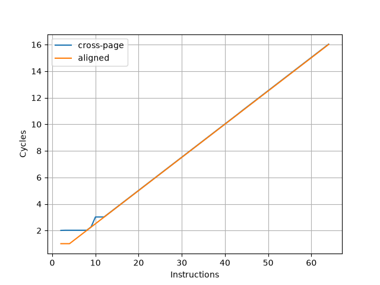

图中蓝线（cross-page）即上述第一条指令在第一个页、其余指令在第二个页的情况；横坐标是第二个页内的指令数，因此一次循环的指令数为横坐标 +1。纵坐标是多次循环的总周期数除以循环次数，即平均每次循环耗费的周期数。当循环指令数达到 9 条时，曲线多出一个周期，说明第二个页里的 8 条指令只需一个周期，即每个周期取 8 条指令。

Chips and Cheese 认为这是 16 B/cycle，但我认为应该是 32 B/cycle。他们应该没有实际测量，只是根据发射宽度推测。

为了确认瓶颈确实在取指，又构造了一组把所有指令放进同一个页内的实验，此时取指不再是瓶颈（图中 aligned）。两条曲线的对比可以清楚地支持上述结论。

指令数继续增加后，瓶颈转移到每周期能执行的 NOP 数量上，两条线随之重合。

### Decode

官方信息：译码宽度为 4。

### L1 ITLB

官方信息：**64 项**指令 TLB。

构造一系列 B 指令，让它们分布在不同的页上，使 ITLB 成为瓶颈，在 LA464 上测试：

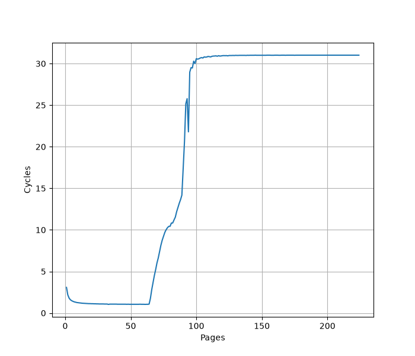

在 64 个页时，CPI 从 1 快速上升，对应 64 项的 L1 ITLB 容量。

### L1 ICache

官方信息：**64KB**，4 路组相联。

为了测 L1 ICache 容量，构造了一个指令 footprint 很大的循环：循环体由大量 4 字节 NOP 和末尾一条分支指令组成，观察不同 footprint 下的 IPC：

footprint 小于 64 KB 时 IPC 可以达到 4，之后开始下降，这个 64 KB 就对应 L1 ICache 的容量。

footprint 超出 L1 ICache、进入 L2 范围后，IPC 下降比较明显；看起来要么没有指令预取器，要么预取器没有针对这种大量 NOP 的场景做适配。

[测试过程详见测试代码](https://github.com/jiegec/cpu-micro-benchmarks/blob/master/src/fetch_bandwidth_gen.cpp)。

### Return Stack

构造不同深度的调用链，测量每次调用的平均耗时，在 LA464 上得到下图：

调用链深度到 32 时性能突然变差，因此 LA464 的 Return Stack 深度为 32，与 Chips and Cheese 的结果一致。

### BTB

构造大量无条件分支指令（B 指令）。BTB 需要记录这些分支的目的地址，因此分支数量超过 BTB 容量后，性能会明显下降。把 B 指令紧密放置，即每 4 字节一条时：

分支数在 96 以内时 CPI 可以达到 1；超过 96 后出现 CPI 为 3 的平台，说明 BTB 容量是 96。

超出 BTB 容量后，分支预测阶段无法从 BTB 获知哪些指令是分支，只能等到取指甚至译码后才发现，由此带来性能损失，这就是 CPI 为 3 的来源。第二个拐点在 16384，对应的是指令 footprint 超出 L1 ICache 的情况：64KB 按每 4 字节一条 B 指令计算，最多容纳 16384 条。

把分支间距增大到 8B：

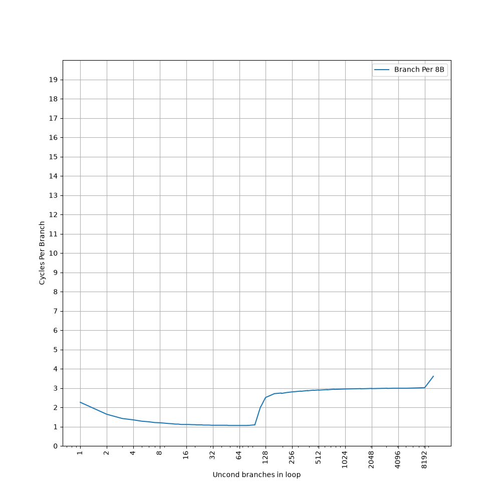

BTB 容量不变，仍为 96；第二个拐点提前到 8K，同样对应 64KB 的 L1 ICache，说明它的 BTB 是全相联的。

Chips and Cheese 测得的是 64 项，估计他们只测了 2 的幂次，看到 64 条分支快、128 条慢就下了结论；实际应该是 96 项。

## 后端

### Register File

官方信息：定点物理寄存器 **128** 项、向量物理寄存器 **128** 项。

为了测物理寄存器堆的大小，在开头和结尾各放一个依赖链很长的操作，中间填入若干无关指令来消耗物理寄存器条目，结果见下图：

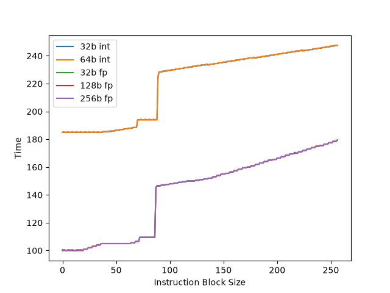

- 32b/64b int：测试 speculative 32/64 位整数寄存器的数量，拐点在 88
- 32b/128b/256b fp/vec：测试 speculative 32/128/256 位浮点或向量寄存器的数量，拐点在 86

加上大约 32 个架构寄存器，以及其他可能需要 rename 的寄存器，基本能对上 128 这个数字。

### Execution Units

官方信息：**4 个定点、2 个向量、2 个访存功能部件**。**每个向量部件 256 位宽，最多支持 8 个单精度或 4 个双精度乘加运算**。

实测这些指令的吞吐如下：

- 分支指令如 beq 每周期一条
- ALU 指令如 add.d 每周期四条
- 向量指令如 vadd.d 每周期两条
- ld.d 每周期两条
- st.d 每周期一条
- xvfmadd.d 和 xvfmadd.s 都是每周期两条，对应每周期 8 个双精度 FMA 和 16 个单精度 FMA

延迟如下：

- mul: 4
- fadd/vfadd/xvfadd/fmul/vfmul/xvfmul/fmadd/vfmadd/xvfmadd: 5

Chips and Cheese 对 FMA 吞吐的分析有误：每周期确实可以执行两条 256b FMA。

### Scheduler

官方信息：发射队列分为访存、定点、向量三类，每类 **32** 项。

在开头放一串长延迟指令（一串 fsqrt.d），让后面的访存、定点或浮点指令依赖它，末尾再放一串长延迟指令，以此测试发射队列深度，结果如下：

- 访存：ldx.d 到 29 条时队列满；考虑到前面的 ftintrz.l.d 和 movfr2gr.d 可能也会走访存队列，与官方信息中的 32 项基本吻合
- 定点：add.d 到 32 条整数指令（movfr2gr.d、beq、ftintrz.l.d、movfr2gr.d、slli.d 以及多条 add.d）时队列满，与官方信息吻合
- 浮点：fadd.d 也差不多在 32 条时队列满

### LSU

官方信息：访存部件支持 **256** 位存储访问，虚地址 64 位、物理地址 48 位；load 队列 **64** 项、store 队列 **48** 项；支持 Non-blocking 访问和 Load-Speculation。

#### Load/Store Queue

引入一系列 load/store 指令，让它们阻塞在队列里，以此测试队列深度：

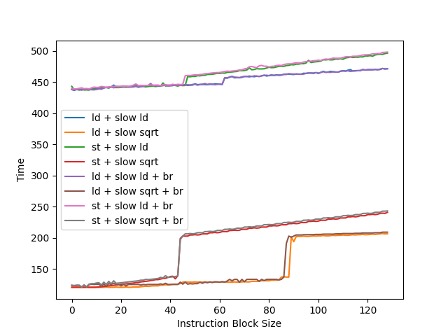

Load 的拐点在 64，Store 的拐点在 48；80+ 处的拐点来自整数寄存器堆。

Chips and Cheese 测得 Store Queue 为 44 项，差别不大。

#### Load Store 带宽

实测 LA464 每周期可以完成以下访存操作：

- 2x 32b/64b/128b/256b Load
- 1x 32b/64b/128b/256b Store
- 1x 64b Load + 1x 64b Store: 1 cycle
- 1x 128b Load + 1x 128b Store: 1 cycle
- 1x 256b Load + 1x 256b Store: 1 cycle

即每周期可读 64 字节、写 32 字节，或读写各 32 字节。

#### Store to Load Forwarding

实测 LA464 在以下情况下可以成功转发。设 Store 地址为 x、Load 地址为 y，转发成功时 y-x 的取值范围如下：

| Store\Load | 8b Load | 16b Load | 32b Load | 64b Load |
|------------|---------|----------|----------|----------|
| 8b Store   | {0}     | {}       | {}       | {}       |
| 16b Store  | [0,1]   | {0}      | {}       | {}       |
| 32b Store  | [0,3]   | [0,2]    | {0}      | {}       |
| 64b Store  | [0,7]   | [0,6]    | [0,4]    | {0}      |

成功转发的条件：Store 的范围完全覆盖 Load，且不跨越缓存行边界；一个 Load 不能从多个 Store 转发数据。这一条件与 [AMD Zen5](./amd-zen5.md) 相同。

当 Load 与 Store 不重叠、且不在同一个对齐的 8B 内时，可以同时完成，只需一个周期；若在同一个对齐的 8B 内但不重叠，则退化为串行执行，需要两个周期；若两者重叠且转发成功，需要七个周期；若重叠但转发失败、且没有跨越缓存行，则需要 14 个周期。

重叠时，即使跨越了对齐的 8B，只要不跨越缓存行边界，仍然可以成功转发；一旦跨越缓存行，转发失败，退化到 22 个周期。

### L1 DCache

官方信息：**64KB**，4 路组相联。

用不同 footprint 的随机 pointer chasing load 测试性能，得到下图：

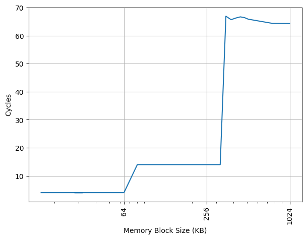

64KB 处出现明显拐点：命中 L1 DCache 时 load to use latency 为 4 cycle，命中 L2 时增大到 14 cycle。

### L1 DTLB

官方信息：**64** 项全相联。

用不同 footprint 的随机 pointer chasing load，且每次 load 落在单独的页内，测试性能，得到下图：

64 页处出现明显拐点；命中 L1 DTLB 时 load to use latency 为 4 cycle。

### L2 TLB

官方信息：2048 项为 8 路组相联，支持可变页大小。

使用 footprint 更大的随机 pointer chasing load，每次 load 仍落在单独的页内，得到下图：

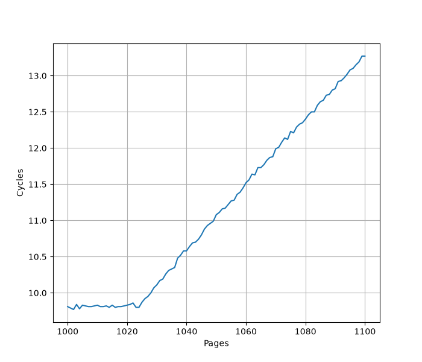

1024 页处出现明显拐点，说明这个核只能用数据填满一半的 L2 TLB 容量。

### L2 Cache

官方信息：256KB Victim Cache，16 路组相联，每核私有。

用不同 footprint 的随机 pointer chasing load 测试性能，得到下图：

命中 L2 时延迟为 14 cycle；直到 320KB 才出现新的拐点，而 320KB 正好是 L1 DCache 的 64KB 与 L2 Cache 的 256KB 之和。

### L3 Cache

官方信息：3A5000 的 L3 为 16MB，3C5000 的 L3 为 32MB。

使用 footprint 更大的随机 pointer chasing load 测试性能：

按时间计：

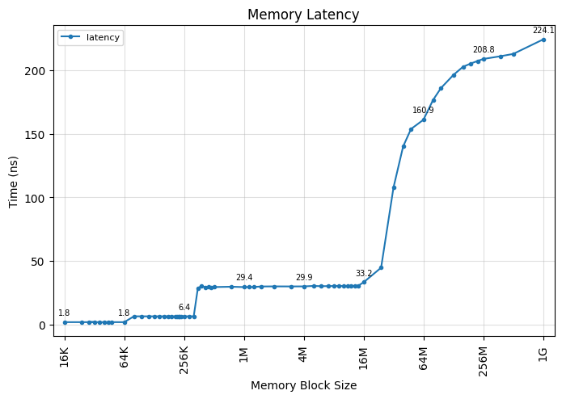

按周期计：

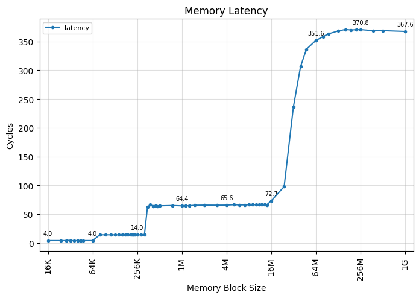

3C5000 的 L3 是 32MB，但延迟在更小的 footprint 下就开始上升。按官方信息，它的 L3 Cache 分为四个 partition，因此可能存在远近之分，或者每个核只能用到其中一部分 L3。

### 访存带宽

用 LASX 的 xvld/xvst 指令测试不同大小数组的访存带宽：

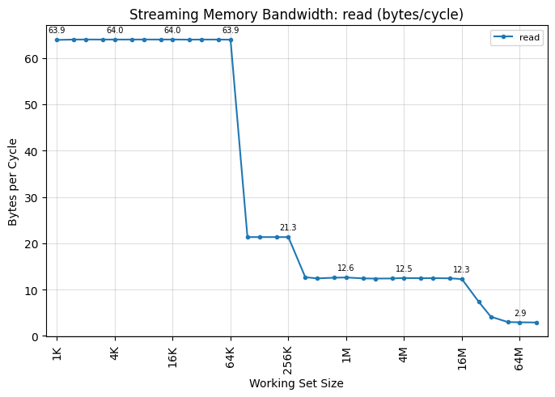

在 L1 范围内，Load 带宽打满 64B/cycle；到 L2 区间下降到 21B/cycle，到 L3 区间进一步降到 12B/cycle。

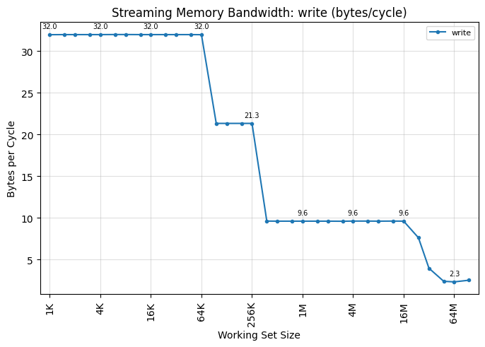

在 L1 范围内，Write 带宽打满 32B/cycle；到 L2 区间下降到 21B/cycle，到 L3 区间进一步降到 10B/cycle。

### Prefetcher

官方信息：结构图中 L2（VCACHE）内有一个 Prefetch engine。

实测 LA464 确实带有预取器：

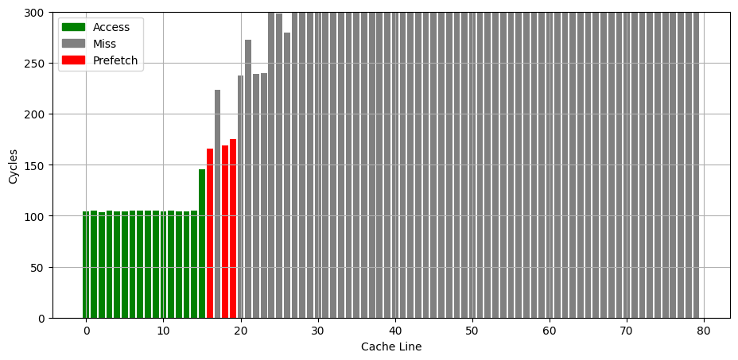

顺序访问 16 个 cacheline 后，第 16 个会落在 L2，之后的一部分 cacheline 也会被预取进 L2。

### ReOrder Buffer

官方信息：ROB **128** 项。

用两个长延迟的指令链，夹住若干条 NOP 指令，测试性能：

可见 ROB 大小为 128 项。
