# Loongson LA664 微架构评测

## 背景

之前分析的大多是国外的微架构，龙芯的却一直没怎么研究过。既然 LA864 快要来了，那就赶在它之前分析一下 [LA464](./loongson-la464.md) 和 LA664，也是为 [Unofficial LoongArch Software Optimization Guide](https://jia.je/unofficial-loongarch-software-optimization-guide/) 积攒数据。测试环境是 3C6000/S @ 2.2GHz。

<!-- more -->

## 官方信息

Loongson 公开的 LA664 微架构官方信息如下：

- [龙芯 3A6000 产品页](https://www.loongson.cn/product/show?id=26)：2.0GHz-2.5GHz，240GFlops，典型功耗 38W@2.5GHz
- [龙芯 3A6000 发布报道](https://www.loongson.cn/news/show?id=638)（2023 龙芯产品发布暨用户大会，2023-11-28）
- [《龙芯 3A6000 数据手册》V1.5](https://www.loongson.cn/uploads/images/2025093014105554649.Loongson3A6000%20data%20book_V1.5.pdf)：六发射乱序执行、4 个定点 + 4 个向量 + 4 个访存单元、各级 Cache 容量
- [《龙芯 3A6000 处理器寄存器使用手册》V1.2](https://www.loongson.cn/uploads/images/2024072510054986439.Loongson3A6000%20user%20book_V1.2.pdf)：第 8 章为 LA664 处理器核
- [龙芯官网下载中心](https://www.loongson.cn/download/index)：上述手册的下载页面

2023 年的发布会上，胡伟武展示了 LA464 与 LA664 的微架构对比，这是目前公开的最详细的 LA664 官方参数：

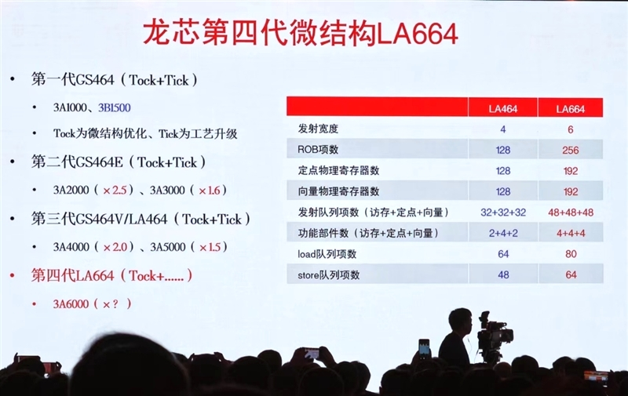

（本页及下文的发布会幻灯片照片均出自[该报道](https://news.mydrivers.com/1/948/948522.htm)）

官方公布的逐项参数如下：

| 参数 | LA464 | LA664 |
| --- | --- | --- |
| 发射宽度 | 4 | 6 |
| ROB 项数 | 128 | 256 |
| 定点物理寄存器数 | 128 | 192 |
| 向量物理寄存器数 | 128 | 192 |
| 发射队列项数（访存+定点+向量） | 32+32+32 | 48+48+48 |
| 功能部件数（访存+定点+向量） | 2+4+2 | 4+4+4 |
| load 队列项数 | 64 | 80 |
| store 队列项数 | 48 | 64 |

3A6000 数据手册和寄存器使用手册还给出了完整的芯片级参数：

- 六发射 64 位超标量结构，支持 SMT2，每个物理核包含两个逻辑核，全芯片 4 物理核 8 逻辑核
- 4 个定点、4 个向量、4 个访存功能部件；每个向量部件 256 位，最多支持 8 个单精度或 4 个双精度乘加
- 每核 64KB L1I + 64KB L1D，4 路组相联；256KB Victim Cache 作为私有 L2，16 路组相联；片内 16MB 分体共享 L3
- 访存部件支持 256 位访问，虚地址 64 位、物理地址 48 位；支持 Non-blocking 访问和 Load-Speculation
- 2 个 72 位 DDR4-3200 控制器（支持 ECC），1 个 16 位 HT 3.0 控制器（最高 6.4Gbps）
- 双精度峰值 240GFlops@2.5GHz，典型功耗 38W@2.5GHz

发布会上展示的 3A6000 规格页如下：

数据手册给出的 3A6000 芯片结构如图 1.1 所示：4 个 LA664 核通过 L1X/L2X 两级交叉开关连接 4 块共享三级 Cache，再连到内存控制器和 IO-Ring。

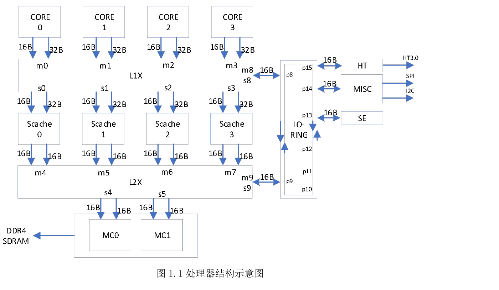

## 现有评测

网上已有不少针对 LA664 微架构的评测和分析，建议阅读：

- [Loongson 3A6000: A Star among Chinese CPUs](https://old.chipsandcheese.com/2024/03/13/loongson-3a6000-a-star-among-chinese-cpus/)

下面按模块分别记录官方信息与实测结果。读者可以对照已有的第三方评测理解。官方信息与实测结果一致的数据会加粗。

## Benchmark

Loongson LA664 的性能测试结果见 [SPEC](../../../benchmark/index.md)。

## 前端

### Fetch

为了测出实际的取指宽度，我参考 [如何测量真正的取指带宽（I-fetch width） - JamesAslan](https://zhuanlan.zhihu.com/p/720136752) 构造了测试。

原理是：取指跨页时，相邻两个页可能映射到不同的物理地址；若要在一个周期内完成跨页取指，就得查询两次 ITLB，或者让 ITLB 把相邻两页的映射放在一起。这种场景比较少见，处理器一般不会专门优化，但也不是没有。实测把循环放在两个页的边界上，LA664 遇到跨页取指时确实会拆成两个周期。

在此基础上构造一个循环：第一条指令放在第一个页的最后四个字节，其余指令放在第二个页。这样每次循环的取指时间等于一个周期（取第一个页内的指令）加上第二个页内指令所需的取指周期数；多出来的这一个周期，正好可以把取指宽度从后端限制中分离出来。实验结果如下：

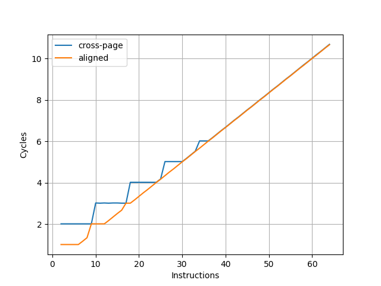

图中蓝线（cross-page）即上述第一条指令在第一个页、其余指令在第二个页的情况；横坐标是第二个页内的指令数，因此一次循环的指令数为横坐标 +1。纵坐标是多次循环的总周期数除以循环次数，即平均每次循环耗费的周期数。当循环指令数达到 9 条时，曲线多出一个周期，说明第二个页里的 8 条指令只需一个周期，即每个周期取 8 条指令。

为了确认瓶颈确实在取指，又构造了一组把所有指令放进同一个页内的实验，此时取指不再是瓶颈（图中 aligned）。两条曲线的对比可以清楚地支持上述结论。

Chips and Cheese 认为这是 24 B/cycle，但我认为应该是 32 B/cycle。他们应该没有实际测量，只是根据发射宽度推测。

指令数继续增加后，瓶颈转移到每周期能执行的 NOP 数量上，两条线随之重合。

和 LA464 相比，取指宽度没有变化。不过 NOP 执行变快后，两条曲线之间的空隙更明显了，说明在六发射下，8 宽取指的余量已经不大；估计到 LA864 时，取指需要做得更宽。取指宽度与 Intel Golden Cove 相同，但 x86 是变长指令集，LoongArch 是定长指令集，每条指令 4 字节。

### Decode

官方信息：译码宽度为 6。

这一点与 Intel Golden Cove 相同。

### L1 ITLB

构造一系列 B 指令，让它们分布在不同的页上，使 ITLB 成为瓶颈，在 LA664 上测试：

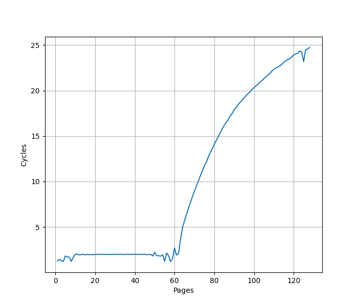

在 64 个页时，CPI 从 1 快速上升，对应 64 项的 L1 ITLB 容量。

容量与 LA464 相同；超出 L1 ITLB 后，延迟比 LA464 有所降低。这一容量只有 Intel Golden Cove 256 项 ITLB 的四分之一。

### L1 ICache

官方信息：每核 **64KB**，4 路组相联。

为了测 L1 ICache 容量，构造了一个指令 footprint 很大的循环：循环体由大量 4 字节 NOP 和末尾一条分支指令组成，观察不同 footprint 下的 IPC：

footprint 小于 64 KB 时 IPC 可以达到 6，之后开始下降，这个 64 KB 就对应 L1 ICache 的容量。

footprint 超出 L1 ICache、进入 L2 后，IPC 下降明显；看起来仍然是没有指令预取器，或者没有针对大量 NOP 的场景做适配。

容量与 LA464 相同，但 IPC 有所提升。超出 L1 ICache 后，LA664 的 IPC 仍明显高于 LA464（接近 2 倍），估计是 L2 Cache 到 L1 ICache 的 refill 带宽更高。这部分结果与 Chips and Cheese 不太一致。容量是 Intel Golden Cove 的两倍，但超出 L1I 后，Golden Cove 的 IPC 仍能保持在 4 以上。

[测试过程详见测试代码](https://github.com/jiegec/cpu-micro-benchmarks/blob/master/src/fetch_bandwidth_gen.cpp)。

### Return Stack

构造不同深度的调用链，测量每次调用的平均耗时，得到下图：

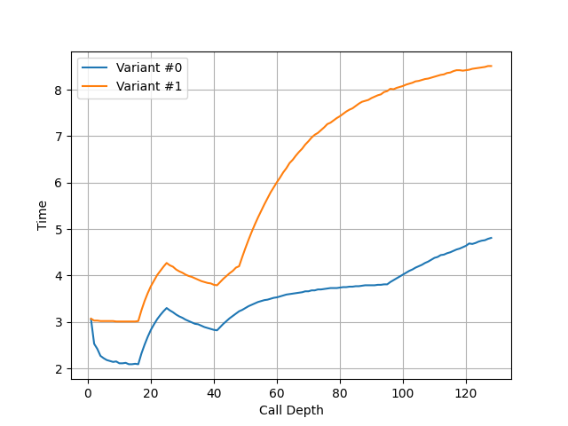

调用链深度到 16 时性能突然变差，因此 LA664 的 Return Stack 深度为 16。LA464 的 Return Stack 深度是 32，LA664 反而变小了；与 Intel Golden Cove 的 20 项相比也略少。

### BTB

构造大量无条件分支指令（B 指令）。BTB 需要记录这些分支的目的地址，因此分支数量超过 BTB 容量后，性能会明显下降。把 B 指令紧密放置，即每 4 字节一条时：

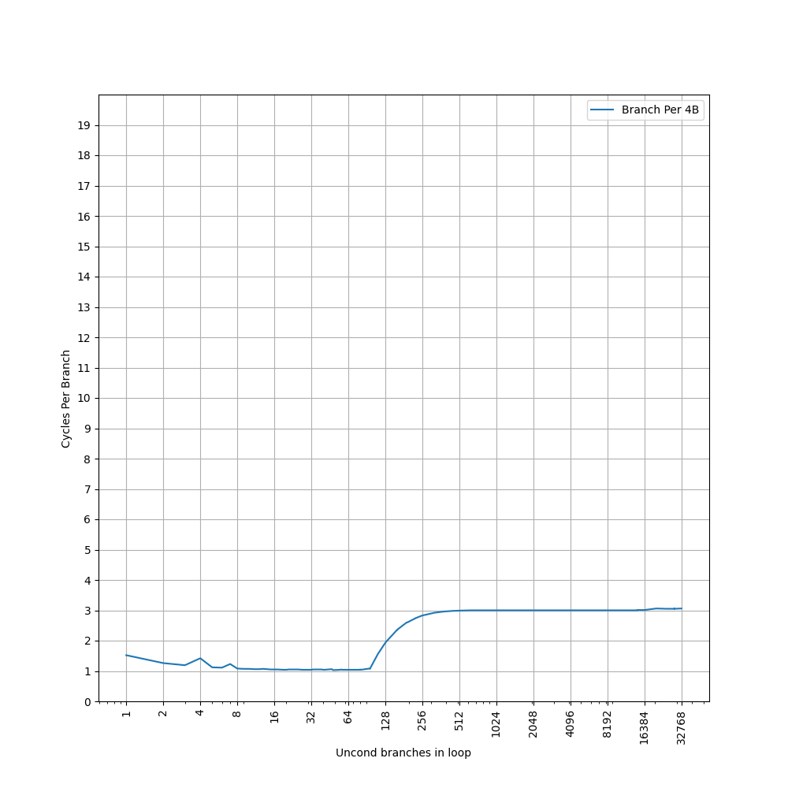

把间距增大到每 8 字节一条 B 指令：

LA664 与 LA464 一样，也是 96 项全相联 BTB；超出 BTB 容量后，只能回到 64KB 的 L1 ICache 里取指、译码。footprint 超过 64KB 后，LA664 的性能比 LA464 好，原因估计仍是上面提到的 L2 Cache 到 L1 ICache refill 路径变快。96 项全相联 BTB 在容量上尚可，与 Neoverse V1 持平，但没有 L2 BTB，容易出现瓶颈。

### CBP

为了测试 LA664 的条件分支预测器，参考 [Half&Half](https://halfandhalf.cpusec.org/) 构造了一个 gadget，首先是一个按随机数 k 跳转的条件分支，接着是若干个无条件的 dummy branch，最后又是根据同一个 k 跳转的条件分支，观察分支预测错误率。发现 LA664 的全局历史长度是 96：

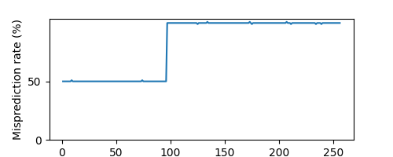

接着，参考 [iEnFlow](https://dl.acm.org/doi/10.1145/3830454.3832569) 里我的做法，把随机数 k 植入到间接分支的不同目的地址位上，经过一系列 dummy branch 后，观察根据同一个 k 跳转的分支的分支预测错误率：

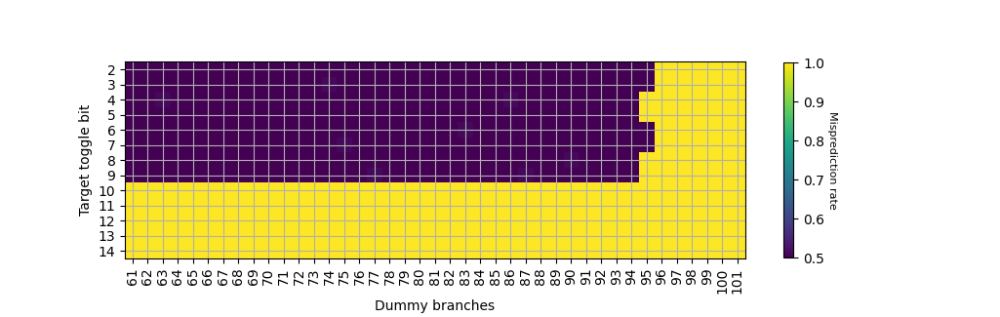

再注入到间接分支的分支地址的不同位上：

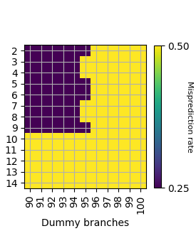

可见 footprint 应该是：

- footprint[0]: T[2] xor T[3] xor T[6] xor T[7] xor B[2] xor B[5] xor B[6] xor B[9]
- foorprint[1]: T[4] xor T[5] xor T[8] xor T[9] xor B[3] xor B[4] xor B[7] xor B[8]

## 后端

### Register File

官方信息：定点物理寄存器 192 项、向量物理寄存器 192 项。

为了测物理寄存器堆的大小，在开头和结尾各放一个依赖链很长的操作，中间填入若干无关指令来消耗物理寄存器条目，结果见下图：

- 32b/64b int：测试 speculative 32/64 位整数寄存器的数量，拐点在 155
- 32b/128b/256b fp/vec：测试 speculative 32/128/256 位浮点或向量寄存器的数量，拐点在 153

加上大约 32 个架构寄存器，以及其他可能需要 rename 的寄存器，基本能对上 192 这个数字，相比 LA464 的 128 提升了不少。

### Execution Units

官方信息：4 个定点、4 个向量、4 个访存功能部件。每个向量部件 256 位宽，最多支持 8 个单精度或 4 个双精度乘加运算。

实测这些指令的吞吐如下：

- 分支指令如 beq 每周期两条，相比 LA464 翻倍（前提是不跳转）
- CRC 指令如 crc.w.b.w 每周期两条，相比 LA464 提升数倍
- ALU 指令如 add.d 每周期四条，和 LA464 持平
- 向量指令如 vadd.d 每周期四条，相比 LA464 翻倍
- ld.d 每周期两条，和 LA464 持平
- st.d 每周期两条，相比 LA464 翻倍
- xvfmadd.d 和 xvfmadd.s 都是每周期两条，对应每周期 8 个双精度 FMA 和 16 个单精度 FMA，和 LA464 持平

延迟如下：

- mul: 4
- fadd/vfadd/xvfadd: 3
- fmul/vfmul/xvfmul/fmadd/vfmadd/xvfmadd: 5

### Scheduler

官方信息：译码后的指令分别进入访存、定点、向量三个发射队列，每类 48 项。

在开头放一串长延迟指令（一串 fsqrt.d），让后面的访存、定点或浮点指令依赖它，末尾再放一串长延迟指令，以此测试发射队列深度，结果如下：

- 到访存 ldx.d 指令，到 48 条 ldx.d 时队列满，和官方信息吻合
- 到整数 add.d，到 46 条 add.d 时队列满，和官方信息基本吻合
- 到浮点 fadd.d，是到 48 条的时候队列满

相比 LA464，发射队列容量扩大到 1.5 倍。

### LSU

官方信息：访存部件支持 256 位存储访问，虚地址 64 位、物理地址 48 位；load 队列 80 项、store 队列 64 项；支持 Non-blocking 访问和 Load-Speculation。

#### Load/Store Queue

引入一系列 load/store 指令，让它们阻塞在队列里，以此测试队列深度：

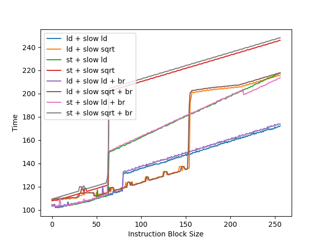

Load 的拐点在 80，Store 的拐点在 64；150+ 处的拐点来自整数寄存器堆。

相比 LA464，Load 和 Store 各多了 16 项。

#### Load Store 带宽

实测 LA664 每周期可以完成以下访存操作：

- 2x 32b/64b/128b/256b Load
- 2x 32b/64b/128b/256b Store
- 2x 64b Load + 2x 64b Store: 1 cycle
- 2x 128b Load + 2x 128b Store: 1 cycle
- 1x 256b Load + 1x 256b Store: 1 cycle

即每周期可读 64 字节、写 64 字节，或读写各 32 字节；相比 LA464 有一定改善。由于没有 512 位宽的向量，并行度不够，访存性能受限。

#### Store to Load Forwarding

实测 LA664 在以下情况下可以成功转发。设 Store 地址为 x、Load 地址为 y，转发成功时 y-x 的取值范围如下：

| Store\Load | 8b Load | 16b Load | 32b Load | 64b Load |
|------------|---------|----------|----------|----------|
| 8b Store   | {0}     | {}       | {}       | {}       |
| 16b Store  | [0,1]   | {0}      | {}       | {}       |
| 32b Store  | [0,3]   | [0,2]    | {0}      | {}       |
| 64b Store  | [0,7]   | [0,6]    | [0,4]    | {0}      |

成功转发的条件：Store 的范围完全覆盖 Load，且不跨越缓存行边界；一个 Load 不能从多个 Store 转发数据。这一条件与 [AMD Zen5](./amd-zen5.md) 相同。

当 Load 与 Store 不重叠、且不在同一个对齐的 8B 内时，可以同时完成，平均每 0.5 个周期完成一个 Load+Store；若在同一个对齐的 8B 内但不重叠，则退化为串行执行，平均每个周期完成一个 Load+Store；若两者重叠且转发成功，需要七个周期；若重叠但转发失败、且没有跨越缓存行，则需要 14 个周期。

重叠时，即使跨越了对齐的 8B，只要不跨越缓存行边界，仍然可以成功转发；一旦跨越缓存行，转发失败，退化到 15 个周期。

可见 LA664 的 Store to Load Forwarding 实现与 LA464 相同，性能差异主要来自每周期能完成更多的 Load 和 Store。

### L1 DCache

官方信息：每核 64KB，4 路组相联。

用不同 footprint 的随机 pointer chasing load 测试性能，得到下图：

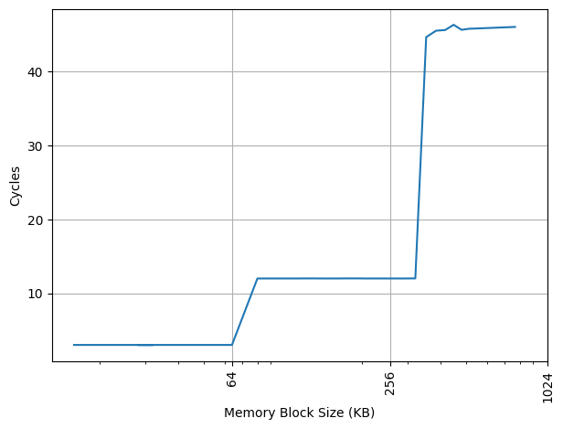

64KB 处出现明显拐点：命中 L1 DCache 时，pointer chasing 的 load to use latency 为 3 cycle（其他情况为 4 cycle），命中 L2 时增大到 12 cycle。

容量与 LA464 相同，但延迟有所下降。它比 Intel Golden Cove 的 48KB 大一些。针对 pointer chasing 做的三周期优化值得好评。

### L1 DTLB

用不同 footprint 的随机 pointer chasing load，且每次 load 落在单独的页内，测试性能，得到下图：

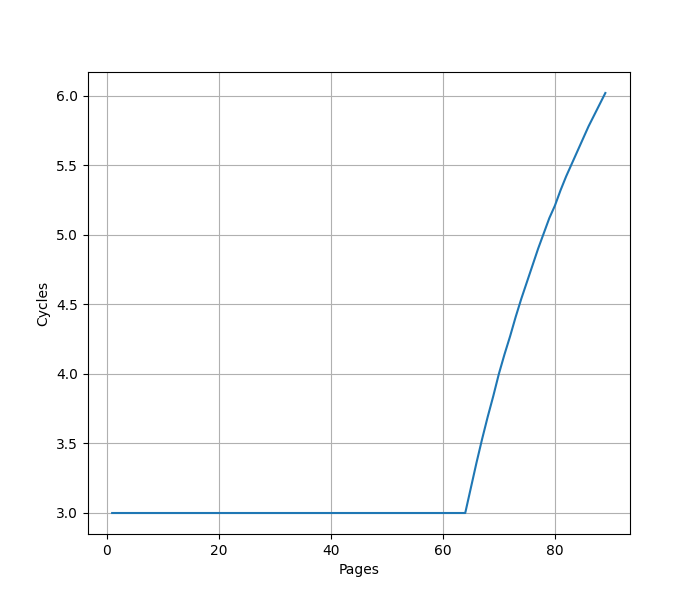

64 页处出现明显拐点；命中 L1 DTLB 时 load to use latency 为 3 cycle（前提是 pointer chasing）。

容量与 LA464 相同，比 Intel Golden Cove 的 96 项要少。

### L2 TLB

使用 footprint 更大的随机 pointer chasing load，每次 load 仍落在单独的页内，得到下图：

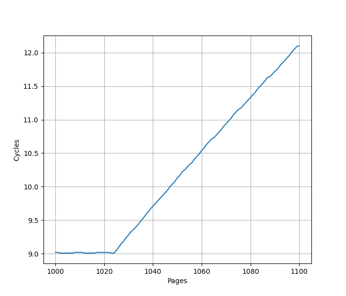

1024 页处出现明显拐点，说明用数据最多只能填满 1024 项 L2 TLB；和 LA464 一样，总数应该是 2048 项。Intel Golden Cove 也是 2048 项。

### L2 Cache

用不同 footprint 的随机 pointer chasing load 测试性能，得到下图：

命中 L2 时延迟为 12 cycle；直到 320KB 才出现新的拐点，而 320KB 正好是 L1 DCache 的 64KB 与 L2 Cache 的 256KB 之和。

容量与 LA464 相同，但延迟有所下降；横向对比，L2 容量已经算比较小的了。

### L3 Cache

官方信息：3A6000 的 L3 是 16MB，3C6000 每硅片的 L3 Cache 容量是 32MB。

使用 footprint 更大的随机 pointer chasing load 测试性能：

按时间计：

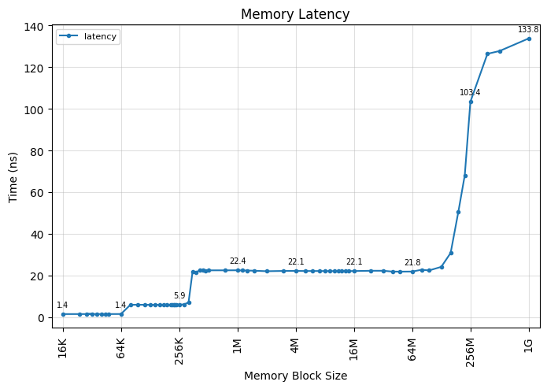

按周期计：

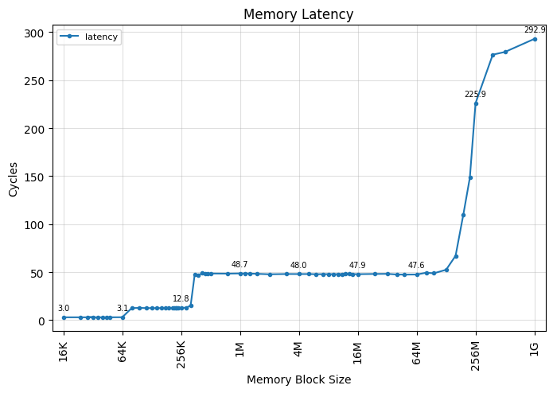

3C6000 的 L3 是 32MB，与 3C5000 相同，但实测延迟要到 96MB 之后才开始上升；并且各区间延迟都比 3C5000 低：L1 从 4 周期降到 3 周期，L2 从 14 周期降到 12 周期，L3 从 65 周期降到 48 周期，进步明显。

### 访存带宽

用 LASX 的 xvld/xvst 指令测试不同大小数组的访存带宽：

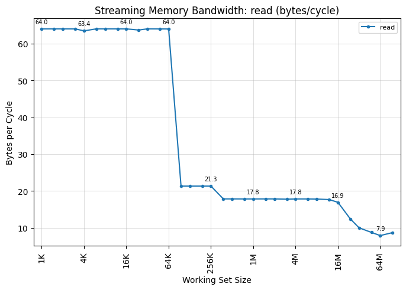

在 L1 范围内，Load 带宽打满 64B/cycle；到 L2 区间下降到 21B/cycle，到 L3 区间进一步降到 18B/cycle。相比 LA464，L3 区间带宽是它的 1.5 倍。

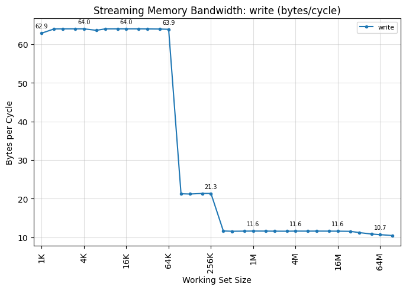

在 L1 范围内，Write 带宽打满 64B/cycle；到 L2 区间下降到 21B/cycle，到 L3 区间进一步降到 12B/cycle。相比 LA464，L1 带宽翻倍，L3 区间带宽略有提升。

### ReOrder Buffer

官方信息：ROB 256 项。

用两个长延迟的指令链，夹住若干条 NOP 指令，测试性能：

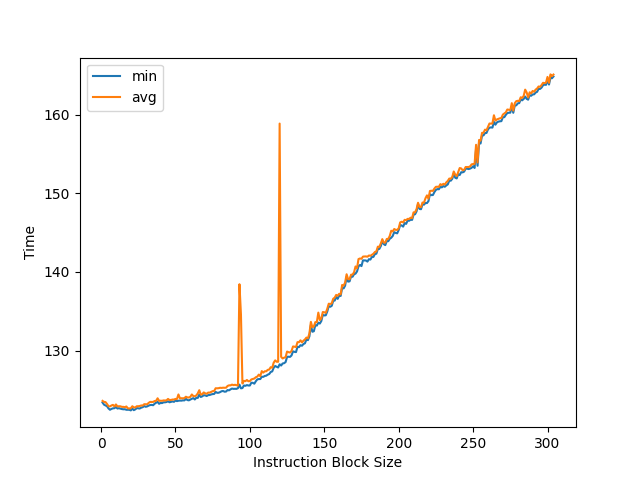

可见 ROB 大小为 256 项。
