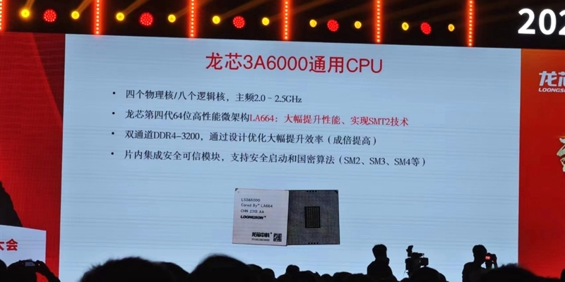
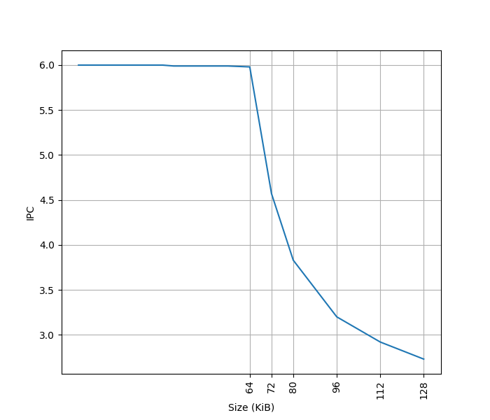
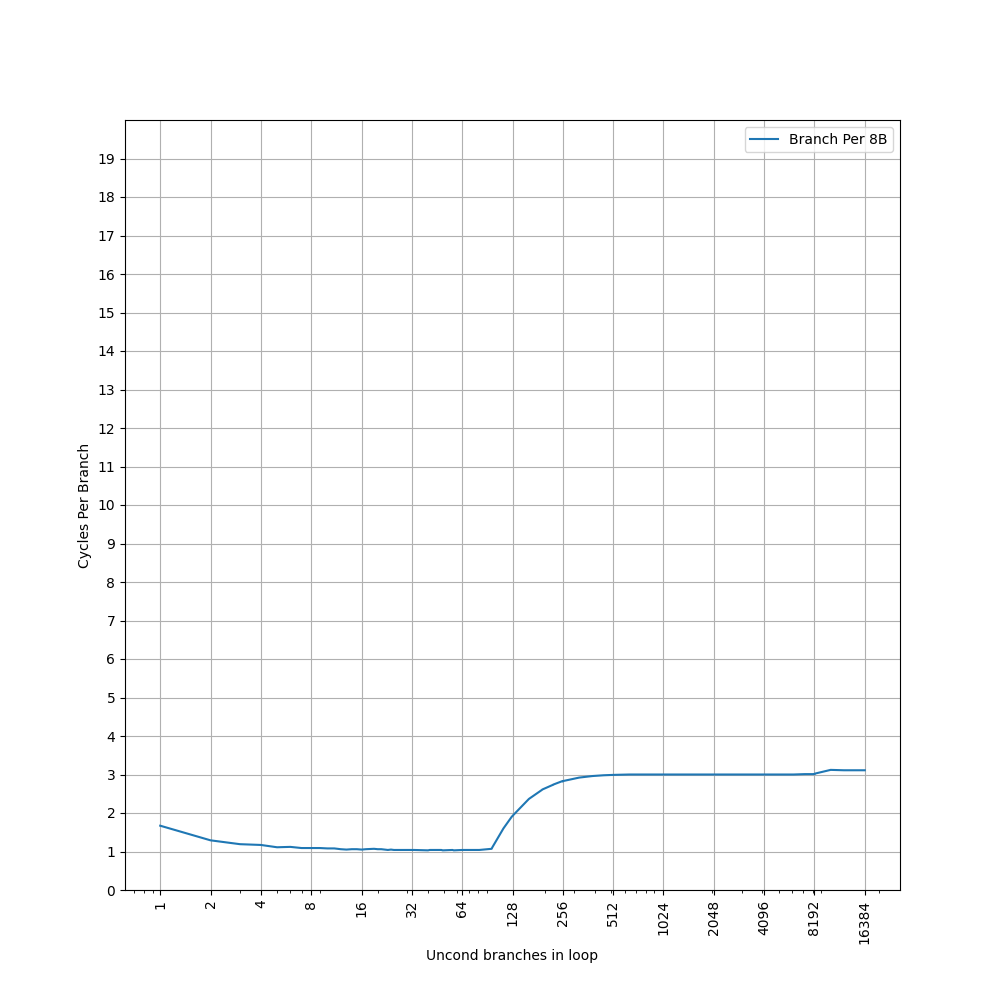
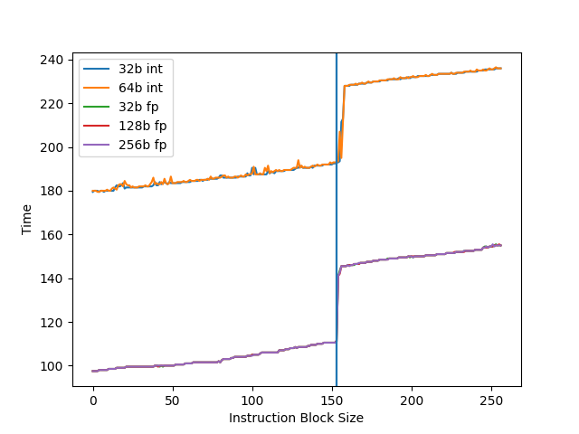

# Loongson LA664 微架构评测

## 背景

之前分析了很多国外的微架构，而龙芯的微架构一直都没怎么研究过。既然 LA864 快要来了，那就在它来之前分析一下 [LA464](./loongson-la464.md) 和 LA664。

<!-- more -->

## 官方信息

Loongson 关于 LA664 微架构有这些官方的信息：

- [龙芯 3A6000 产品页](https://www.loongson.cn/product/show?id=26)：2.0GHz-2.5GHz，240GFlops，典型功耗 38W@2.5GHz
- [龙芯 3A6000 发布报道](https://www.loongson.cn/news/show?id=638)（2023 龙芯产品发布暨用户大会，2023-11-28）
- [《龙芯 3A6000 数据手册》V1.5](https://www.loongson.cn/uploads/images/2025093014105554649.Loongson3A6000%20data%20book_V1.5.pdf)：六发射乱序执行、4 个定点 + 4 个向量 + 4 个访存单元、各级 Cache 容量
- [《龙芯 3A6000 处理器寄存器使用手册》V1.2](https://www.loongson.cn/uploads/images/2024072510054986439.Loongson3A6000%20user%20book_V1.2.pdf)：第 8 章为 LA664 处理器核
- [龙芯官网下载中心](https://www.loongson.cn/download/index)：上述手册的下载页面

2023 年的发布会上，胡伟武展示了 LA464 与 LA664 的微架构对比，这是目前公开的最具体的 LA664 官方参数：

（本页及下文中的发布会幻灯片照片均出自[该报道](https://news.mydrivers.com/1/948/948522.htm)）

官方给出的逐项参数如下：

| 参数 | LA464 | LA664 |
| --- | --- | --- |
| 发射宽度 | 4 | 6 |
| ROB 项数 | 128 | 256 |
| 定点物理寄存器数 | 128 | 192 |
| 向量物理寄存器数 | 128 | 192 |
| 发射队列项数（访存+定点+向量） | 32+32+32 | 48+48+48 |
| 功能部件数（访存+定点+向量） | 2+4+2 | 4+4+4 |
| load 队列项数 | 64 | 80 |
| store 队列项数 | 48 | 64 |

3A6000 数据手册和寄存器使用手册还给出了完整的芯片级参数：

- 六发射 64 位超标量结构，支持 SMT2，每个物理核包含两个逻辑核，全芯片 4 物理核 8 逻辑核
- 4 个定点、4 个向量、4 个访存功能部件；每个向量部件 256 位，最多支持 8 个单精度或 4 个双精度乘加
- 每核 64KB L1I + 64KB L1D，4 路组相联；256KB Victim Cache 作为私有 L2，16 路组相联；片内 16MB 分体共享 L3
- 访存部件支持 256 位访问，虚地址 64 位、物理地址 48 位；支持 Non-blocking 访问和 Load-Speculation
- 2 个 72 位 DDR4-3200 控制器（支持 ECC），1 个 16 位 HT 3.0 控制器（最高 6.4Gbps）
- 双精度峰值 240GFlops@2.5GHz，典型功耗 38W@2.5GHz

发布会上展示的 3A6000 规格页如下：

数据手册给出的 3A6000 芯片结构如图 1.1 所示，4 个 LA664 核通过 L1X/L2X 两级交叉开关连接 4 块共享三级 Cache，并连接到内存控制器和 IO-Ring：

## 现有评测

网上已经有较多针对 LA664 微架构的评测和分析，建议阅读：

- [Loongson 3A6000: A Star among Chinese CPUs](https://old.chipsandcheese.com/2024/03/13/loongson-3a6000-a-star-among-chinese-cpus/)

下面分各个模块分别记录官方提供的信息，以及实测的结果。读者可以对照已有的第三方评测理解。官方信息与实测结果一致的数据会加粗。

## Benchmark

Loongson LA664 的性能测试结果见 [SPEC](../../../benchmark/index.md)。

## 前端

### Fetch

为了测试实际的 Fetch 宽度，参考 [如何测量真正的取指带宽（I-fetch width） - JamesAslan](https://zhuanlan.zhihu.com/p/720136752) 构造了测试。

其原理是当 Fetch 要跨页的时候，由于两个相邻页可能映射到不同的物理地址，如果要支持单周期跨页取指，需要查询两次 ITLB，或者 ITLB 需要把相邻两个页的映射存在一起。这个场景一般比较少，处理器很少会针对这种特殊情况做优化，但也不是没有。经过测试，把循环放在两个页的边界上，发现 LA664 微架构遇到跨页的取指时确实会拆成两个周期来进行。

在此基础上，构造一个循环，循环的第一条指令放在第一个页的最后四个字节，其余指令放第二个页上，那么每次循环的取指时间，就是一个周期（读取第一个页内的指令）加上第二个页内指令需要 Fetch 的周期数，多的这一个周期就足以把 Fetch 宽度从后端限制中区分开，实验结果如下：

图中蓝线（cross-page）表示的就是上面所述的第一条指令放一个页，其余指令放第二个页的情况，横坐标是第二个页内的指令数，那么一次循环的指令数等于横坐标 +1。纵坐标是运行很多次循环的总 cycle 数除以循环次数，也就是平均每次循环耗费的周期数。可以看到，到 9 条指令的时候，多了一个周期，意味着第二个页里的 8 条指令只需要一个周期，每个周期取 8 条指令。

为了确认这个瓶颈是由取指造成的，又构造了一组实验，把循环的所有指令都放到一个页中，这个时候 Fetch 不再成为瓶颈（图中 aligned），两个曲线的对比可以明确地得出上述结论。

随着指令数进一步增加，最终瓶颈在每周期执行的 NOP 指令数，因此两条线重合。

和 LA464 相比，取指宽度没有变化。但是，因为 NOP 执行变快了，两条线之间开始出现了更明显的空隙，这意味着六发射下，八宽的取指的余量已经没那么大了，估计到 LA864 的时候，取指得做得更宽。

### Decode

官方信息：译码宽度为六。

### L1 ITLB

构造一系列的 B 指令，使得 B 指令分布在不同的 page 上，使得 ITLB 成为瓶颈，在 LA664 上进行测试：

在 64 个页的时候，CPI 从 1 Cycle 快速增加，对应了 64 项的 L1 ITLB 容量。

容量和 LA464 相同。超出 L1 ITLB 时，延迟相比 LA464 有所降低。

### L1 ICache

官方信息：每核 **64KB**，4 路组相联。

为了测试 L1 ICache 容量，构造一个具有巨大指令 footprint 的循环，由大量的 4 字节 nop 和最后的分支指令组成。观察在不同 footprint 大小下的 IPC：

可以看到 footprint 在 64 KB 之前时可以达到 6 IPC，之后开始下降，这里的 64 KB 就对应了 L1 ICache 的容量。

容量和 LA464 相同，不过 IPC 有所上升。在超出 L1 ICache 区间里，LA664 的 IPC 也比 LA464 要高，估计 LA664 从 L2 Cache 到 L1 ICache 的 Refill 带宽要更高。

[测试过程详见测试代码](https://github.com/jiegec/cpu-micro-benchmarks/blob/master/src/fetch_bandwidth_gen.cpp)。

### Return Stack

构造不同深度的调用链，测试每次调用花费的平均时间，在 LA464 上得到下面的图：

可以看到调用链深度为 16 时性能突然变差，因此 LA664 的 Return Stack 深度为 16。考虑到 LA464 时候的 Return Stack 深度就是 32，而 LA664 支持 SMT，大概率就是把 Return Stack 容量一分为二，两个逻辑核各 16 深度了。

### BTB

构造大量的无条件分支指令（B 指令），BTB 需要记录这些指令的目的地址，那么如果分支数量超过了 BTB 的容量，性能会出现明显下降。当把大量 B 指令紧密放置，也就是每 4 字节一条 B 指令时：

每 8 字节一条 B 指令：

LA664 和 LA464 一样，也是 96 项全相连的 BTB，如果超出了 BTB，就要从 64KB 的 L1 ICache 里取指和译码。在超出 64KB 的部分，性能比 LA464 好，估计还是上面说的 L2 Cache 到 L1 ICache 的 refill 路径变快了。

## 后端

### Register File

官方信息：定点物理寄存器 192 项、向量物理寄存器 192 项。

为了测试物理寄存器堆的大小，用两个依赖链很长的操作放在开头和结尾，中间填入若干个无关的指令，并且用这些指令来耗费物理寄存器堆。测试结果见下图：

- 32b/64b int：测试 speculative 32/64 位整数寄存器的数量，拐点在 155
- 32b/128b/256b fp/vec：测试 speculative 32/128/256 位浮点或向量寄存器的数量，拐点在 153

考虑上大约 32 个架构寄存器，还有一些其他可能需要 rename 的寄存器，基本能对的上 192 这个数字。

### Execution Units

官方信息：4 个定点、4 个向量、4 个访存功能部件。每个向量部件 256 位宽，最多支持 8 个单精度或 4 个双精度乘加运算。

经过测试，这些指令的吞吐：

- 分支指令如 beq 每周期两条，相比 LA664 翻倍，前提是不跳转
- CRC 指令如 crc.w.b.w 每周期两条，相比 LA464 提升数倍
- ALU 指令如 add.d 每周期四条，和 LA464 持平
- 向量指令如 vadd.d 每周期四条，相比 LA464 翻倍
- ld.d 每周期两条，和 LA464 持平
- st.d 每周期两条，相比 LA464 翻倍
- xvfmadd.d 和 xvfmadd.s 都是每周期两条，对应每周期 8 个双精度 FMA 和 16 个单精度 FMA，和 LA464 持平

延迟：

- mul: 4
- fadd/vfadd/xvfadd: 3
- fmul/vfmul/xvfmul/fmadd/vfmadd/xvfmadd: 5

### Scheduler

官方信息：译码后的指令分别进入访存、定点、向量三个发射队列，每类 48 项。

### LSU

官方信息：访存部件支持 256 位存储访问，虚地址 64 位、物理地址 48 位；load 队列 80 项、store 队列 64 项；支持 Non-blocking 访问和 Load-Speculation。

#### Load/Store Queue

#### Load Store 带宽

#### Store to Load Forwarding

### L1 DCache

官方信息：每核 64KB，4 路组相联。

### L1 DTLB

### L2 TLB

### L2 Cache

官方信息：每核 256KB Victim Cache，作为私有二级 Cache，16 路组相联。

### L3 Cache

官方信息：4 个核共享 16MB 分体三级 Cache。

### Prefetcher

### ReOrder Buffer

官方信息：ROB 256 项。
